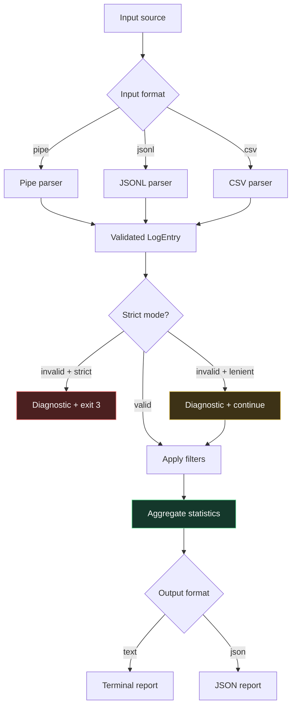

<div align="center">

```text
╔══════════════════════════════════════════════════════════════════════╗
║  █████╗ ██████╗  █████╗  ██████╗███████╗ ██████╗ ██████╗ ███████╗  ║
║ ██╔══██╗██╔══██╗██╔══██╗██╔════╝██╔════╝██╔═══██╗██╔══██╗██╔════╝  ║
║ ███████║██████╔╝███████║██║     █████╗  ██║   ██║██████╔╝█████╗    ║
║ ██╔══██║██╔═══╝ ██╔══██║██║     ██╔══╝  ██║   ██║██╔══██╗██╔══╝    ║
║ ██║  ██║██║     ██║  ██║╚██████╗███████╗╚██████╔╝██║  ██║███████╗  ║
║ ╚═╝  ╚═╝╚═╝     ╚═╝  ╚═╝ ╚═════╝╚══════╝ ╚═════╝ ╚═╝  ╚═╝╚══════╝  ║
╚══════════════════════════════════════════════════════════════════════╝
```

### `offline diagnostics // deterministic analysis // C++17`

[](https://isocpp.org/)
[](https://cmake.org/)
[](#testing-and-quality)

</div>

> A small, offline command-line utility that validates structured diagnostic
> logs, analyzes failures, and produces deterministic text or JSON reports.

```text
┌─[log-analyzer]────────────────────────────────────────────────────────┐
│ status  : READY                                                       │
│ input   : samples/sample.log                                         │
│ records : 5                                                           │
│ errors  : 3                                                           │
│ result  : deterministic report generated                              │
└───────────────────────────────────────────────────────────────────────┘
```

## 01 · Project overview

Log Analyzer turns structured records into useful diagnostic summaries without
network access, databases, hardware integration, or external services. It is
designed as a maintainable C++ learning and engineering project demonstrating
file I/O, validation, modular design, testing, CMake, diagnostics, and CI.

The tool accepts one or more files, standard input, or a selected record format.
It can filter by severity and component, detect repeated errors, identify the
time range, and write reports to the terminal or a file.

## 02 · Capabilities

| Capability | Description |
|---|---|
| `pipe` input | `timestamp|severity|component|message` records |
| `jsonl` input | One JSON object per line |
| `csv` input | Four-field CSV records with quoted fields |
| Multi-file input | Repeat `--input` for multiple files |
| Standard input | Use `--input -` in a pipeline |
| Validation | Calendar, clock, severity, and field validation |
| Recovery modes | Lenient diagnostics or strict fail-fast processing |
| Filtering | Severity, component, or both |
| Analysis | Counts, error components, repeated messages, time range |
| Reports | Human-readable text or dependency-free JSON |
| Determinism | Explicit ordering and stable output |

## 03 · Demo

### Build and run

```bash
cmake -S . -B build -DCMAKE_BUILD_TYPE=Debug
cmake --build build
./build/log_analyzer --input samples/sample.log
```

### Terminal output

```text
Log Analysis Report
===================
Total records: 5
INFO: 1
WARN: 1
ERROR: 3

Errors by component:
  AUDIO: 1
  NETWORK: 2

Repeated errors:
  Connection timeout: 2

Time range:
  Earliest: 2026-10-30 09:15:01
  Latest: 2026-10-30 09:15:12

Parse diagnostics: 0
```

### JSON report

```bash
./build/log_analyzer \
  --input samples/sample.log \
  --format json \
  --output report.json
```

## 04 · Architecture

```mermaid
flowchart LR
    CLI["CommandLine<br/>argument validation"] --> Reader["LogReader<br/>file or stream I/O"]
    Reader --> Parser["LogParser<br/>format and field validation"]
    Parser --> Domain["LogEntry<br/>shared domain model"]
    Domain --> Analyzer["LogAnalyzer<br/>filters and statistics"]
    Analyzer --> Formatter["ReportFormatter<br/>text or JSON"]
    Formatter --> Destination["stdout or output file"]

    style CLI fill:#241b3d,stroke:#9b7dff,color:#fff
    style Parser fill:#241b3d,stroke:#9b7dff,color:#fff
    style Analyzer fill:#14382b,stroke:#56d98b,color:#fff
    style Formatter fill:#14382b,stroke:#56d98b,color:#fff
```



### Module responsibilities

| Module | Responsibility |
|---|---|
| `LogSeverity` | Strongly typed `INFO`, `WARN`, and `ERROR` values |
| `LogEntry` | Timestamped domain record and timestamp comparisons |
| `LogParser` | Parses pipe, JSON Lines, and CSV records |
| `LogReader` | Reads files/streams, tracks lines, applies strict/lenient policy |
| `LogAnalyzer` | Filters records and calculates diagnostic statistics |
| `ReportFormatter` | Renders structured results as text or JSON |
| `CommandLine` | Validates CLI options without business logic |
| `main` | Coordinates the application and maps exit codes |

## 05 · Processing pipeline



## 06 · Technology stack

| Area | Choice | Reason |
|---|---|---|
| Language | C++17 | Modern standard-library features and portability |
| Build | CMake 3.16+ | Reproducible, cross-platform builds |
| Tests | Google Test 1.14.0 | Focused unit and integration testing |
| Compiler | GCC, Clang, or MSVC | Linux/WSL2 target with Windows support |
| Static analysis | clang-tidy | Optional source analysis |
| Runtime checks | AddressSanitizer/UBSan | Optional GCC/Clang diagnostics |
| Debugging | GDB | Linux/WSL2 debugging workflow |
| CI | GitHub Actions | Clean Ubuntu build and test verification |

## 07 · Installation

### Ubuntu or WSL2

```bash
sudo apt update
sudo apt install -y build-essential cmake git
git clone <repository-url>
cd Testing-
```

Google Test is fetched by CMake when no compatible local installation is found.

### Configure and build

```bash
cmake -S . -B build -DCMAKE_BUILD_TYPE=Debug
cmake --build build --parallel
```

### Windows with MinGW

```powershell
cmake -S . -B build-gcc `
  -G "MinGW Makefiles" `
  -DCMAKE_BUILD_TYPE=Debug
cmake --build build-gcc --parallel
```

## 08 · Usage

```text
log_analyzer --input PATH [options]
```

| Option | Meaning |
|---|---|
| `--input PATH` | Input file; repeat for multiple files |
| `--input -` | Read records from standard input |
| `--input-format pipe\|jsonl\|csv` | Select record format; pipe is default |
| `--severity INFO\|WARN\|ERROR` | Include one severity |
| `--component NAME` | Include one component |
| `--strict` | Stop at the first malformed record |
| `--format text\|json` | Select report format; text is default |
| `--output PATH` | Write the report to a file |
| `--help` | Display usage information |

### Pipe input

```text
2026-10-30 09:15:01|ERROR|AUDIO|Device initialization failed
```

```bash
./build/log_analyzer --input app.log --input-format pipe
```

### JSON Lines input

```json
{"timestamp":"2026-10-30 09:15:01","severity":"ERROR","component":"AUDIO","message":"Device failed"}
```

```bash
./build/log_analyzer --input events.jsonl --input-format jsonl
```

### CSV input

```text
2026-10-30 09:15:01,ERROR,AUDIO,"Device failed, retrying"
```

```bash
./build/log_analyzer --input events.csv --input-format csv
```

### Multiple files

```bash
./build/log_analyzer \
  --input logs/app-1.log \
  --input logs/app-2.log \
  --format json \
  --output report.json
```

Standard input cannot be combined with file inputs because it is a single
non-repeatable stream:

```bash
cat app.log | ./build/log_analyzer --input - --severity ERROR
```

PowerShell:

```powershell
Get-Content app.log | .\build-gcc\log_analyzer.exe --input -
```

## 09 · Domain contract

- Timestamp format: `YYYY-MM-DD HH:MM:SS`.
- Timestamps are timezone-unspecified; no timezone conversion occurs.
- Supported severities are exactly `INFO`, `WARN`, and `ERROR`.
- Pipe parsing uses the first three delimiters; later delimiters remain in the message.
- Components and messages must not be empty.
- Blank lines are malformed records.
- Lenient mode is the default and reports malformed lines while continuing.
- Strict mode stops at the first malformed record.
- Repeated errors are identical messages among `ERROR` records, occurring more than once.
- Empty input is valid and produces an empty analysis.

## 10 · Testing and quality

### Standard build and tests

```bash
cmake -S . -B build -DCMAKE_BUILD_TYPE=Debug
cmake --build build --parallel
ctest --test-dir build --output-on-failure
```

For Visual Studio multi-configuration builds:

```powershell
cmake --build build --config Debug
ctest --test-dir build -C Debug --output-on-failure
```

### Sanitizers

Use GCC or Clang with sanitizer runtimes installed:

```bash
cmake -S . -B build-sanitized \
  -DCMAKE_BUILD_TYPE=Debug \
  -DENABLE_SANITIZERS=ON
cmake --build build-sanitized
ctest --test-dir build-sanitized --output-on-failure
```

### clang-tidy

```bash
cmake -S . -B build-tidy \
  -DCMAKE_BUILD_TYPE=Debug \
  -DENABLE_CLANG_TIDY=ON
cmake --build build-tidy
```

The project enables `-Wall -Wextra -Wpedantic` for GCC/Clang and `/W4` for
MSVC. The current validation suite contains 28 passing tests. GitHub Actions
repeats the clean Ubuntu configure, build, and CTest workflow from
[ci.yml](.github/workflows/ci.yml).

## 11 · Project structure

```text
.
├── .github/
│   └── workflows/
│       └── ci.yml
├── include/
│   ├── CommandLine.h
│   ├── LogAnalyzer.h
│   ├── LogEntry.h
│   ├── LogParser.h
│   ├── LogReader.h
│   ├── LogSeverity.h
│   └── ReportFormatter.h
├── src/
│   ├── CommandLine.cpp
│   ├── LogAnalyzer.cpp
│   ├── LogParser.cpp
│   ├── LogReader.cpp
│   ├── LogSeverity.cpp
│   ├── ReportFormatter.cpp
│   └── main.cpp
├── tests/
│   ├── CMakeLists.txt
│   ├── test_command_line.cpp
│   ├── test_log_analyzer.cpp
│   ├── test_log_parser.cpp
│   ├── test_log_reader.cpp
│   └── test_report_formatter.cpp
├── samples/
│   └── sample.log
├── CMakeLists.txt
├── README.md
└── .gitignore
```

Generated `build*` directories are local CMake artifacts and are excluded by
`.gitignore`; they are not required in source control.

## 12 · Roadmap

The planned version 1 scope is complete through the current implementation
phase. Possible future work:

- [ ] Improve format diagnostics and add richer JSON validation.
- [ ] Add optional progress reporting for very large inputs.
- [ ] Add more report formats only when a consumer requires them.
- [ ] Add performance benchmarks with reproducible datasets.
- [ ] Add a graphical interface without moving business logic out of the core.

Out of scope for version 1:

- Networking
- Databases
- GUIs
- Multithreading
- Plugins
- Hardware, ECU, RTOS, or vehicle integration
- External AI services

## 13 · Contribution

1. Create a focused branch.
2. Keep parser, reader, analyzer, formatter, and CLI responsibilities separate.
3. Add or update tests for behavior changes.
4. Run the build and CTest commands locally.
5. Keep output deterministic.
6. Update this README when CLI behavior changes.
7. Open a pull request with a concise summary and validation results.

Please do not commit generated `build*` directories, compiler databases, or
local IDE metadata.

## Exit codes

```text
0  Successful execution
1  Fatal input/output or processing failure
2  Invalid command-line usage
3  Strict-mode data validation failure
```

## Scope note

This is an offline diagnostic utility using simulated logs. It does not claim
hardware, ECU, RTOS, vehicle, networking, database, GUI, multithreading,
plugin, or external AI integration.
